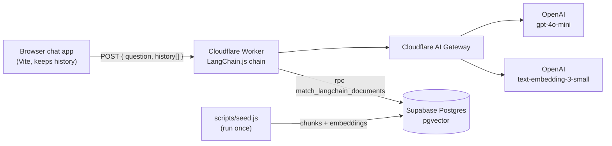

# Scrimba Support Bot

A conversational support chatbot that answers questions about Scrimba from a knowledge base, built with a LangChain.js retrieval chain on Supabase pgvector.

**Live demo:** https://scrimba-bot-app.mkarlen96.workers.dev


## Architecture



OpenAI calls go through Cloudflare AI Gateway (logging, caching, rate limiting). Keys live only in Worker secrets.

## How it works

**Indexing (once, `npm run seed`):** `data/scrimba-info.txt` is split with `RecursiveCharacterTextSplitter` (500 chars, 50 overlap), embedded with `text-embedding-3-small` and stored via `SupabaseVectorStore` in the `langchain_documents` table.

**Per question — a `RunnableSequence` of three steps:**
1. **Standalone question.** An LLM prompt rewrites the user question plus conversation history into a self-contained question (e.g. resolves "it" / "that course").
2. **Retrieval.** The standalone question goes to the Supabase vector store retriever (`match_langchain_documents`, top-4 by cosine similarity); the documents are joined into a context string.
3. **Answer.** A second prompt answers from the retrieved context and the conversation history. If the answer is not there, the bot says it doesn't know and points to help@scrimba.com instead of making something up. `temperature: 0`.

**Conversation memory** lives in the browser as an array of alternating question/answer strings and is sent with every request; the Worker is stateless and uses the last 20 messages. "New chat" clears it.

## Stack

- **Frontend:** vanilla JS + Vite, deployed as Cloudflare Workers static assets
- **Backend:** Cloudflare Worker (`nodejs_compat`)
- **AI:** LangChain.js (`@langchain/core` runnables & prompt templates, `@langchain/openai`, `@langchain/community` SupabaseVectorStore), OpenAI `gpt-4o-mini` + `text-embedding-3-small`
- **Vector DB:** Supabase Postgres + `pgvector` (row level security on; only the secret key can read/write)

## Project structure

```
worker/                     Cloudflare Worker: POST { question, history } → { answer }   :8792
  src/index.js              standalone-question → retriever → answer chain
  supabase/setup.sql        langchain_documents table + match_langchain_documents()
  scripts/seed.js           split + embed + upload the knowledge base
  data/scrimba-info.txt     knowledge base
app/                        Vite chat UI with suggested questions                        :5175
```

## Run locally

Requires Node 20+, an OpenAI API key and a Supabase project.

```bash
# 1. Database: Supabase Dashboard → SQL Editor → paste worker/supabase/setup.sql → Run

# 2. Worker
cd worker
npm install
cp .dev.vars.example .dev.vars   # OPENAI_API_KEY, SUPABASE_URL, SUPABASE_API_KEY (secret / service_role key)
npm run seed                     # uploads the knowledge base to Supabase
npx wrangler dev                 # http://localhost:8792

# 3. Frontend (second terminal)
cd app
npm install
cp .env.example .env.development.local   # points the app at the local worker
npm run dev                              # http://localhost:5175
```

## Deploy

```bash
cd worker
npx wrangler secret bulk .dev.vars   # OPENAI_API_KEY, SUPABASE_URL, SUPABASE_API_KEY
npm run deploy

cd ../app
echo "VITE_SCRIMBA_WORKER_URL=https://<your-worker>.workers.dev" > .env.production.local
npm run deploy                       # vite build + wrangler deploy
```

---

Built as part of the **AI Engineering Specialization (Coursera × Scrimba)** — final project of the *Build AI Apps with LangChain.js* course.

License: [MIT](LICENSE)
